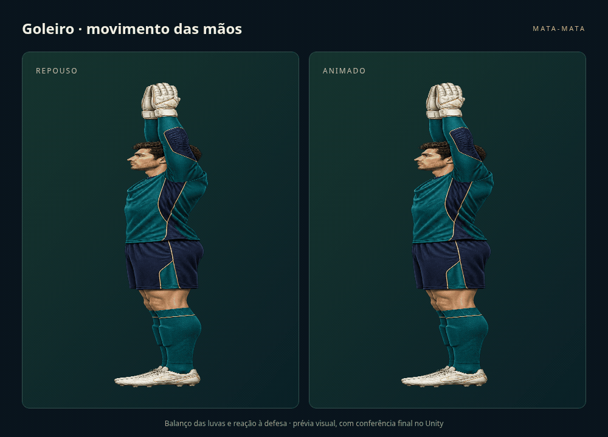

# Futebol mata-mata · World Cup e Legends

Projeto Unity atualizado a partir do backup, com os cenários Champions League,
Europa League, World Cup e Legends. A World Cup tem ano editável.

**[Baixar o projeto completo](https://github.com/Robertogirao/futebol-mata-mata/archive/refs/heads/main.zip)**

## Como abrir

1. Baixe o ZIP acima e extraia os arquivos.
2. No Unity Hub, use **Add / Adicionar projeto** e selecione a pasta que contém
   `Assets`, `Packages` e `ProjectSettings`.
3. Use **Unity 6000.4.11f1**, a versão do backup original.
4. Abra `Assets/Scenes/DEMO_WorldCup_16.unity` ou `DEMO_Legends_16.unity` e clique em Play.
   As demonstrações têm apresentação inicial e pré-jogo antes de começar a partida.

As demos de Champions e Europa continuam disponíveis. As cenas novas
`MataMata_WorldCup_32` e `MataMata_Legends_32` têm as 32 fichas preenchidas.

## Mãos do goleiro

As luvas têm balanço suave, ajuste à bola próxima e reação curta ao contato com a bola.
O tronco e a base permanecem estáveis. O movimento congela durante a pausa.
A dificuldade, a IA, o movimento vertical e os colisores continuam os mesmos.

No objeto **TournamentManager**, no componente **MataMataCampeonato**, clique em
**Editar ano, fontes, cores e visual deste cenário**. No tema, procure:

| Campo | O que muda |
| --- | --- |
| Animar Mãos Goleiro | Liga ou desliga a animação |
| Velocidade Mãos Goleiro | Ritmo do balanço |
| Amplitude Mãos Goleiro | Quanto as mãos se deslocam |
| Reação Mãos Goleiro | Quanto acompanham a bola próxima |

A prévia é uma reprodução visual da deformação em WebGL, **não uma gravação do Unity**.
A máscara dos braços foi ajustada à arte `Goleiro_Premium`; outra pose pode precisar de ajuste.

## Outros ajustes incluídos

- Um único titular por equipe, compartilhado entre o cartão e os lançamentos de bolas.
  O elenco completo e o limite total de seis bolas foram preservados.
- Bola pontuada desaparece imediatamente, inclusive no gol de ouro; a mesma bola
  não pode pontuar duas vezes.
- Proteção para bolas que ficam orbitando junto da chuteira, com busca de uma saída livre
  fora do raio de giro e intervalo curto contra recaptura.
- Quatro artes de estádio, goleiro e hélice renovados; placar, cartões e banner de gol novos.
- Câmera mais afastada e HUD menor, com fontes e cores editáveis.
- Ano da World Cup refletido no título, placar e chaveamento, com progresso separado por ano.

As fichas novas são exemplos editáveis, sem vínculo com uma lista oficial de classificados
ou um elenco de um ano específico. As fotos disponíveis no backup foram reaproveitadas
quando correspondiam ao jogador; nos demais casos foram usados monogramas.

## Instruções e verificação

Consulte **[COMECE_AQUI.txt](COMECE_AQUI.txt)** para mudar o ano, o titular, o zoom,
as fontes e as cores. Há mais detalhes em **[ALTERACOES_E_TESTES.md](ALTERACOES_E_TESTES.md)**.

Foram executadas análise sintática dos 26 arquivos C#, compilação de compatibilidade
fora do Unity, validação das referências das cenas e testes do modelo de chaveamento.
A prévia WebGL também foi renderizada e conferida: houve movimento na parte superior
sem alteração da base do personagem.

**O editor Unity não está instalado no ambiente de preparação.** A compilação final
no Unity 6000.4, o shader URP e a simulação física ainda precisam da conferência no Play Mode.
Os oito testes de regressão incluídos podem ser executados em:
**Window → General → Test Runner → PlayMode → Run All**.
